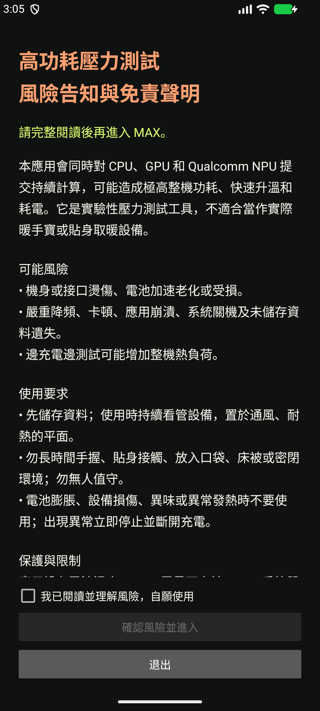

# MAX 手机暖手实验室

**这是实验性高功耗压力测试工具，不适合实际暖手或贴身取暖。使用前请阅读风险说明。**

[下载 v0.2.1 实验版 APK](https://github.com/tuxKOH/MAX_phone_hand_warmer/releases/tag/v0.2.1) · [验证范围](docs/VALIDATION.md) · [第三方许可](docs/THIRD_PARTY.md)

## 风险告知与免责声明

本应用会持续向 CPU、GPU 和 Qualcomm NPU 提交计算，可能导致极高整机功耗、快速升温和耗电。开发期间使用者曾反馈约 **45 W 整机功耗**；这是使用者观察值，测量位置、工具及充电条件未经本项目独立核验，不能视为应用测得的芯片功率或通用性能指标。

可能风险包括机身或接口烫伤、电池加速老化或损坏、严重降频、卡顿、崩溃、系统关机和未保存资料丢失。边充电边测试可能进一步增加热负荷。

- 先保存资料，并持续看管设备，放在通风、耐热的平面上。
- 勿长时间手握、贴身接触、放入口袋、床被或密闭环境；勿无人值守。
- 电池膨胀、设备损伤、异味或异常发热时不要使用；出现异常立即停止并断开充电。
- 不要以绕过系统温控、强行锁频或禁用保护来追求分数。

应用在电池温度达到 45°C、电量不高于 15%、系统热状态达到严重等级、传感值缺失、离开前台或达到时限时停止。单次最长 5 分钟。**电池温度不代表芯片、外壳或接口温度，这些保护不构成人身或设备安全保证。** 停止时不再提交新工作；已提交的 GPU 队列和驱动调用仍需完成，设备不会立即冷却。

本工具以现状提供，不承诺性能、温度或适用性；使用者应自行评估设备状况并承担使用风险。本声明不排除法律规定不得免除的责任。应用入口设有默认未勾选的风险确认页，确认前不初始化 QNN 或提交计算负载。

## 工作负载与数据含义

- CPU：每个硬件线程执行多条独立 FP32 NEON FMA 链；工作线程适当降低优先级，为界面和加速器提交留出调度时间。
- GPU：OpenGL ES 3.1 计算着色器，默认 16 条独立 vec4 计算链、512 次循环、262144 个 invocation；四组输出缓冲区与 fence 排队，避免每次 dispatch 后 glFinish。
- NPU：仅使用 QNN HTP，不回退到 CPU。默认 16 层 2048 × 2048 UINT8 仿射量化 MatMul；显示为 INT8 TOPS。运行期间通过官方性能接口请求 DSP/总线、HMX 和 CENG 的性能配置，分别报告是否接受，仍受系统和厂商策略约束。HTP v73（8 Gen 2）使用 DSP/总线性能请求；独立 HMX/CENG 性能请求要求 v75 及以后，v73 不适用。

确认入口声明并进入主界面后，后台准备 HTP context、图和缓冲区。**同一进程、同一 NPU 图配置只编译一次**，之后启动/停止复用已编译图；停止后撤销性能请求，不持续执行推理。进程被杀或安装更新后需要重新编译，未实现磁盘二进制缓存。改变矩阵大小或层数会替换缓存；执行错误使图失效后，下次尝试重建。界面显示成功编译次数。

CPU 显示 GFLOPS，GPU 显示 FP32 TFLOPS，NPU 显示 INT8 TOPS。乘加计 2 次操作，仅累计实际完成的工作：

```text
GPU FLOPs / dispatch = 262144 × iterations × chains × 4 × 2
NPU ops / graph      = 2 × matrix³ × layers
吞吐                  = 完成次数 × 每次操作数 / 采样秒数
```

数值是测试算子逻辑工作量换算的吞吐，会受编译器优化影响，不是硬件指令计数、利用率或瓦数。界面即时值约每 0.5 秒采样；会话平均值包含该次会话的初始化与释放。官方 TOPS 需核对精度、稀疏性、统计范围与频率条件，不能直接用本测试分数除以官方峰值当作 NPU 利用率。成功执行图也不代表达到最大功耗。

## 目标平台

| 平台 | SoC | HTP | 验证状态 |
| --- | --- | --- | --- |
| Snapdragon 8 Gen 2 | SM8550 | v73 | SDK 明列支持，已配置；未做本项目真机验证 |
| Snapdragon 8 Gen 3 | SM8650 | v75 | 已配置，未做本项目真机验证 |
| Snapdragon 8 Elite | SM8750 | v79 | 旧版已验证真实 HTP 执行；最新缓存改动仅构建检查 |
| Snapdragon 8 Gen 5 | SM8845 | 待探测 | 实验性；当前 SDK 芯片表未明列，不能承诺支持 |
| Snapdragon 8 Elite Gen 5 | SM8850 | v81 | 已配置，未做本项目真机验证 |

GPU 要求 ES 3.1。x86_64 模拟器没有 Qualcomm HTP；当前模拟器仅声明 ES 3.0，其 GPU 测试会明确跳过。

## 构建

需要 Java 17、Android SDK 36、NDK 27.0.12077973、CMake 3.22.1，以及完整且版本一致的 Qualcomm QAIRT SDK。

```bash
export JAVA_HOME=/usr/lib/jvm/java-17-openjdk-amd64
export QNN_SDK_ROOT=/path/to/qairt/2.48.0.260626
python3 scripts/stage-qnn.py
./gradlew assembleDebug assembleDebugAndroidTest lintDebug --console=plain
```

产物：`app/build/outputs/apk/debug/app-debug.apk`。SDK 库存放于被忽略的 `app/src/main/jniLibs/arm64-v8a/`；请遵守高通 SDK 的使用和分发条款。未提供 SDK 时 ARM64 构建不包含 HTP 实现。应用原生库启用了灵活页面支持，已检查手机 CPU 侧 ELF LOAD 段至少按 16 KB 对齐。

## 验证与复测工具

以下命令仅用于使用者主动发起的验证，不会在安装或普通构建时自动执行。压力测试前须阅读风险说明。

入口流程可在模拟器通过专用 `gate` 模式验证，不启动压力负载。普通 smoke 模式会实际施加短时负载；运行前应自行确认设备状态与上述风险。

```bash
adb -s DEVICE install -r app/build/outputs/apk/debug/app-debug.apk
adb -s DEVICE install -r app/build/outputs/apk/androidTest/debug/app-debug-androidTest.apk
adb -s DEVICE shell am instrument -w -e mode gate dev.maxheater.test/dev.maxheater.SmokeInstrumentation
```

`scripts/bench-device.py` 是显式调用的短测工具，按项保存手机端结果，并尽力采集 KGSL GPU 忙碌率和频率。无线 ADB 采样超时不会抹掉手机端报告；忙碌率总计数为零时标为未知。case 0/1/2 是 NPU 1024/2048/3072，case 3/4 是 GPU 队列深度 1/4，case 5 是三路同时运行。手机必须解锁且保持应用前台。每项计算最长 9 秒，图准备另行计时。

```bash
python3 scripts/bench-device.py --serial DEVICE --case 1 --output artifacts/npu-2048.txt
adb -s DEVICE shell run-as dev.maxheater cat files/workload-bench.txt
```

验证结果及限制见 [验证范围](docs/VALIDATION.md)。原始设备日志和真机截图不随公开源码发布。当前没有可靠数据证明 NPU 达到 80 TOPS 或 GPU 持续 100%。

<details>
<summary>入口风险确认页</summary>



</details>
